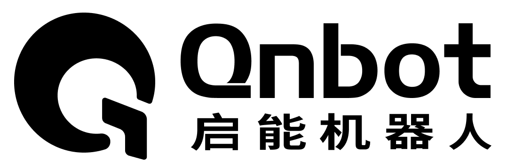
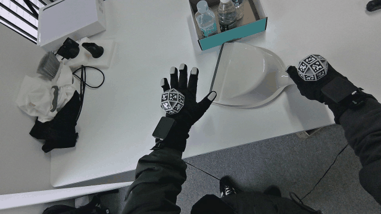
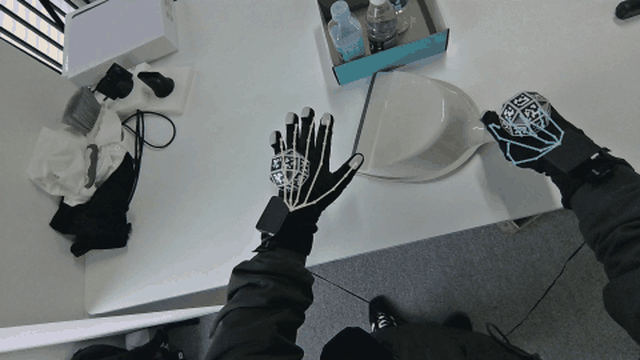
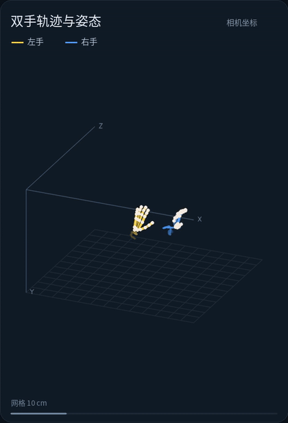
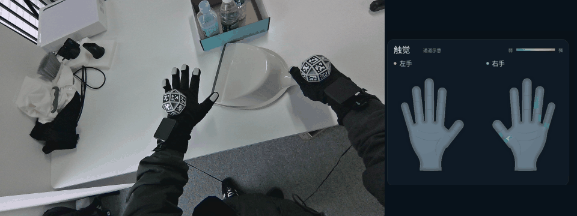
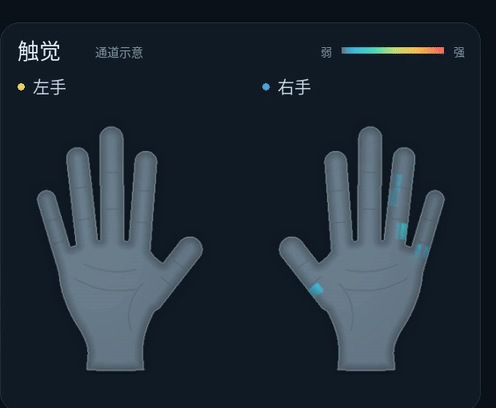

# Qn_EgoTAC_Smith




EGO 采集数据的 AprilTag 空间位姿、手套 HumanHandV2 骨骼映射、触觉变化 与 视频结果核查工具 整个工作流。支持 HDF5 与  MCAP 录制文件，提供统一命令行和 Python API，方便开发者集成到自己的平台。


## 处理效果

### 处理前：原始 RGB

采集时的头部相机画面，未叠加处理结果。



### 处理后：骨骼与轨迹

展示 HumanV2 手部骨骼映射。



### 双手姿态与轨迹

固定视角展示相机坐标系下的双手骨骼姿态及运动轨迹，黄色为左手，蓝色为右手。



### 触觉变化

颜色代表相对固定基线的通道变化，经过死区和颜色映射，不是标定后的力值；通道在指尖与指腹的实际对应仍待确认。

下方左侧为操作员的原始画面，右侧为对应时刻的触觉变化。



触觉手图放大：




## 能做什么

- 读取原始数据、绑定对应相机与个人标定，记录 SHA256、原时间轴和有效掩码，不回写原素材。
- Ball23 AprilTag 定位 → 底面 → EMF 线圈中心 → 五点手套解算 HumanV2 → 投影到原始 RGB。
- **可选**视觉根定位：SAM3 / EfficientSAM3 分割与 HaWoR/MANO 提供根部辅助，保持相同的 HumanV2 局部手型。证据冲突保留 NaN。
- 触觉固定基线、MAD 死区与平滑颜色映射；16:9 RGB、触觉手图、固定视角双手轨迹/骨骼核查视频。
- 已关闭录制的离线处理、Tag 初检后选择视觉的交互示例，；实时预览接口需要另行提供已授权的相机后端。

输出是**相机光学坐标下**的运动，未去除相机运动，不能称为固定世界轨迹。不包含物品重建、机器人重定向或 RL。`training_ready` 默认 `false`，视频成功不等于标定或训练质量验收。


## 安装与快速调用

支持 Linux x86_64、Python **3.12**；基础依赖固定 OpenCV-contrib 4.11。建议独立环境，不复用采集端环境。当前支持从源码目录运行，尚不将 wheel 作为包含原生库/模型的独立发布包。

已测试设备：**GPD MicroPC 2（Intel N350 版本）**，8 核 CPU、16 GB 共享内存及 Intel 集成显卡。mini PC 的视觉推理使用 OpenVINO GPU。

```bash
git clone https://github.com/qnbot-technology/Qn_EgoTAC_Smith.git
cd Qn_EgoTAC_Smith
# 准备授权资产；检查基础模型（只读）
python3 scripts/install_assets.py --bundle-root /path/to/authorized-bundle --check
# 核验后实体复制模型；不覆盖已有不匹配文件
python3 scripts/install_assets.py --bundle-root /path/to/authorized-bundle
# 准备 Python 3.12 后安装。bootstrap 最后执行 doctor，缺原生资源会报错。
PYTHON=python3.12 bash scripts/bootstrap.sh --visual
.venv/bin/python run_pipeline.py doctor --deep
```

基础流程不需要下载视觉模型，可先执行 `PYTHON=python3.12 bash scripts/bootstrap.sh`（不加 `--visual`）。系统需提供 `ffmpeg` 和 `ffprobe`，例如通过系统包管理器安装。HumanV2 运行包要求 Linux x86_64、glibc 2.38 或更新版本。

不启用视觉也能跑 Tag、骨骼、触觉；使用随附 HumanV2 原生运行库，并提供该录制对应的标定：

```bash
.venv/bin/python run_pipeline.py run \
  --input /path/to/closed-recording.h5 --output reports/tag-only-001 \
  --no-visual-assist --render-video
```

本地 NVIDIA 完整视觉（**显式请求视频**）：

```bash
.venv/bin/python run_pipeline.py run \
  --input /path/to/closed-recording.h5 --output reports/full-001 \
  --visual full --device cuda --gpu 0 --sam-model sam3 \
  --render-video --start-s 2.43 --end-s 16
```

mini PC Intel GPU（IR 需按设备实际导出并核验，目录名是部署示例）：

```bash
bash scripts/bootstrap_minipc.sh
bash scripts/with_intel_opencl.sh .venv/bin/python run_pipeline.py run \
  --input /path/to/recording.mcap --output reports/mcap-full-001 \
  --mcap-reference /path/to/source-bound/reference.json \
  --mcap-offset-profile ball23-h5 --mcap-right-tag-start 13 \
  --mcap-depth-mode metadata --visual full --device cpu --threads 6 \
  --sam-model efficientsam3 --sam-backend openvino \
  --sam-openvino-dir weights/openvino/efficientsam3-evm-gloved-hand-v3-scale8 \
  --hawor-backend openvino \
  --openvino-model weights/openvino/hawor-backbone-v2/model.xml \
  --openvino-device GPU --render-video
```

上例 IR 路径须替换为对应导出工具实际生成且通过 validation 的目录，不能凭目录名称判断模型类型。`--device cpu` 控制 Torch 张量及非导出部分；SAM/HaWoR 空间骨干执行设备由 OpenVINO 参数控制。指定 GPU 失败必须报错，不静默回落 CPU。

先初检 Tag、报告定位无效数量，再**由调用者选择**是否启用视觉：

```bash
.venv/bin/python run_pipeline.py guided-example \
  --input /path/to/closed-recording.h5 --output reports/guided-001
```

示例默认首选 EfficientSAM3；拒绝/未输入则继续 Tag-only。这里报告的是 **Tag 位姿无效帧数**，不是相机采集丢帧。调用顺序见 [交互示例](examples/minipc_tag_then_visual.py)。

## 可选视觉纠正：模型下载与使用

**视觉纠正不是必选步骤。** `--no-visual-assist` 可独立完成读取、AprilTag、HumanV2 骨骼、触觉和可选视频；不需要 SAM3、EfficientSAM3、HaWoR 或 MANO 权重。Tag 无效且没有视觉证据时保留无效标记/NaN，不编造定位。省略该开关时 `run` 默认请求完整视觉；`--visual full` 失败会报错，不静默降级。

启用视觉时，分割器 **SAM3 与 EfficientSAM3 二选一**，同时需要 HaWoR/MANO。视觉只辅助根部坐标，不替换五点解算的 HumanV2 手型。权重均保存在本项目 `weights/` 实体目录，不使用旧工程链接。

视觉功能还需要自行获取 EgoSmith 和其固定的 HaWoR 源码；本仓库不分发这些源码。执行以下命令前，请阅读并遵守各上游项目及模型的许可；商业用途或再分发需自行确认授权。以下固定版本的完整视觉推理尚需在目标设备上验证。

```bash
git clone https://github.com/egosteer/egosmith.git third_party/egosmith
git -C third_party/egosmith checkout dfb1cb2cdc0815a6e8019cd606fad10a40c4a551
git -C third_party/egosmith submodule update --init thirdparty/hawor_upstream thirdparty/chumpy_upstream
bash third_party/egosmith/scripts/setup/fetch_hawor_base.sh
```

上游脚本会在独立的 EgoSmith 检出目录中创建指向其 HaWoR 子模块的相对链接。不要将该目录或受限权重提交到本仓库。基础的 `--no-visual-assist` 流程不需要上述步骤。

| 模块 | 官方下载 / 说明 | 本项目存放路径 | 使用条件 |
|---|---|---|---|
| SAM3 | [官方模型仓库](https://huggingface.co/facebook/sam3) · [源码](https://github.com/facebookresearch/sam3) | `weights/sam3/sam3.pt` | 默认分割器；遵守 SAM License，先申请访问并登录 Hugging Face |
| EfficientSAM3 EV-M | [模型仓库](https://huggingface.co/Simon7108528/EfficientSAM3) · [EV-M checkpoint](https://huggingface.co/Simon7108528/EfficientSAM3/resolve/main/efficientsam3_ft/efficientsam3_efficientvit.pt?download=true) · [源码](https://github.com/SimonZeng7108/efficientsam3) | `weights/efficientsam3/efficientsam3_efficientvit.pt` | 替代 SAM3；当前接入仅支持 Intel OpenVINO GPU，须有经核验 IR；实验模型，非 SAM3-LiteText |
| HaWoR | [checkpoint](https://huggingface.co/ThunderVVV/HaWoR/resolve/main/hawor/checkpoints/hawor.ckpt) · [配置](https://huggingface.co/ThunderVVV/HaWoR/resolve/main/hawor/model_config.yaml) · [源码/模型条款](https://github.com/ThunderVVV/HaWoR) | `weights/hawor/checkpoints/hawor.ckpt`、`weights/hawor/model_config.yaml` | 完整视觉需要；模型 CC BY-NC-ND 4.0，转换/改动后分发权限须另行确认 |
| MANO 左右手 | [官方注册下载](https://mano.is.tue.mpg.de/) · [许可](https://mano.is.tue.mpg.de/license.html) | 右：`weights/mano/data/mano/MANO_RIGHT.pkl`；左：`weights/mano/data_left/mano_left/MANO_LEFT.pkl` | 完整视觉需要；按 MANO 授权取得，不通过非授权镜像再分发 |
| MANO mean params | 取得有权使用的 HaWoR 部署资源，见 [资产清单](weights/manifest.json) | `weights/mano/data/mano_mean_params.npz` | 不假定 MANO 官方下载包自带该文件，不生成虚假占位文件 |

下载示例（在项目根目录执行；仅下载选择的分割器）：

```bash
# SAM3：先在官方模型页面获准访问；令牌只交给 hf 登录工具，不写进代码。
python3 -m pip install huggingface_hub
hf auth login
hf download facebook/sam3 sam3.pt --local-dir weights/sam3

# 或下载 EfficientSAM3 EV-M；下载 checkpoint 后还需导出/核验 OpenVINO IR。
mkdir -p weights/efficientsam3
curl -fL --retry 3 \
  'https://huggingface.co/Simon7108528/EfficientSAM3/resolve/main/efficientsam3_ft/efficientsam3_efficientvit.pt?download=true' \
  -o weights/efficientsam3/efficientsam3_efficientvit.pt

# 两种分割器共用的 HaWoR 资源；MANO 则按上表官方许可手动安装。
mkdir -p weights/hawor/checkpoints
curl -fL --retry 3 \
  https://huggingface.co/ThunderVVV/HaWoR/resolve/main/hawor/checkpoints/hawor.ckpt \
  -o weights/hawor/checkpoints/hawor.ckpt
curl -fL --retry 3 \
  https://huggingface.co/ThunderVVV/HaWoR/resolve/main/hawor/model_config.yaml \
  -o weights/hawor/model_config.yaml
```

下载前确认上游条款与版本；示例会写入目标文件，已有部署请先核对，勿覆盖正在使用的权重。`weights/manifest.json` 是历史已测基础资源的 SHA 清单，包含 SAM3；选 EfficientSAM3 不代表也要下载 SAM3。EV-M 已测 SHA256 为 `086b04b2e7da7cc98aa4621b70c7291608aa9d187357b98d03bd4d6533ed5a17`。在线权重更新若与记录不一致，应单独验证并记录版本，不直接改清单绕过检查。

使用上方快速调用中的 Tag-only、NVIDIA SAM3 或 Intel EfficientSAM3 示例。Intel 分支不能只将 `.pt` 改后缀为 `.xml`：SAM3 使用统一入口 `benchmark-sam3-openvino`，EfficientSAM3 使用 `benchmark-efficientsam3` 的 reference → image → grounding → validate；HaWoR 使用 `benchmark-openvino`。导出需要真实裁剪输入和参考推理；最终 `run` 必须指向对应且通过项目门禁的 IR 与回执。

## 输入数据结构

输入为已结束写入的录制；原文件只读，派生结果写入独立输出目录。以下是当前适配器使用的主要字段。

**HDF5（`.h5`）**：要求文件属性 `complete=1`，主要结构如下（`SIDE` 为 `left` 或 `right`）：

```text
time/relative_s, sample_monotonic_ns            # RGB 样本时轴及主机时钟
raw/cameras/head_rgb/                            # JPEG、接收时间、设备帧索引等
raw/tactile_emf/SIDE/fingertips/native/         # 五点 pose_i16、有效性、接收时间
raw/tactile_emf/SIDE/tactile/native/            # 460 通道触觉计数及有效性
calibration/cameras/head_rgb/color/              # K、distortion、图像尺寸等
calibration/tactile_emf/                        # 协议及本次录制的七姿个人标定
```

五点位置按原生单位转换到米，原始四元数为 `wxyz`；处理时记录时间匹配、有效性与源文件 SHA256。触觉计数可整理为 23×20 通道网格，显示的是基线变化而非标定力值。

**MCAP（`.mcap`）**：当前支持本项目 Qn DAQ v1 的 protobuf 消息，包括以下 topic：

| Topic | 内容 |
|---|---|
| `/camera/head/color`、`/camera/head/depth` | 头部 RGB 和深度帧 |
| `/camera/head/accel`、`/camera/head/gyro` | 相机惯性数据，保留源信息 |
| `/glove/left/moxian`、`/glove/right/moxian` | 双手五点姿态、有效性、板载时间和 460 路触觉计数 |
| `/daq/session`、`/health/daq` | 采集会话和设备状态信息 |

MCAP 还需配套相机与设备 `calibration/`，以及通过 `--mcap-reference` 指定该操作者的七姿个人标定。当前手套板载时钟与相机主机时钟通过区间仿射映射，记录 `synthetic_sync=true`，不等于硬件同步；MCAP 原生解码后，下游目前使用临时 HDF5 兼容视图，运行结束删除。支持的是上述采集协议，不代表所有 ROS MCAP 都可直接使用。

**公开示例数据集**：用于快速验证输入读取和示例流程的 Google Drive 数据集可从[示例数据集页面](https://drive.google.com/file/d/1jU17KVDfG8bYemtuUJG9F8HaUE-GTdYY/view?usp=sharing)下载。下载后请将文件保存到本地工作目录，再根据文件扩展名选择 HDF5 或 MCAP 入口；不要把 Google Drive 的临时下载地址写入配置。该示例由外部存储提供，仓库不重新分发其内容，也不假定其包含本项目所需的个人标定文件。运行前先检查录制是否已关闭、HDF5 的 `complete=1` 或 MCAP 的 Qn DAQ v1 topic 是否齐全，并在输出 `provenance` 中记录下载后的本地文件 SHA256、格式、帧数和标定来源。

## Pipeline：1–12 步

下面按对外集成的 12 个节点划分；括号保留日志实际 stage ID，便于检查 `calls/`。HumanV2 左右手分别调用，最后显示审计仍保留 `13_display_audit` ID。

| 步骤 | 功能 / 实际 stage | 核查内容与中间产物 |
|---|---|---|
| 1 | 读取与绑定 `01_read` | HDF5/MCAP 格式、源 SHA、相机、个人标定、时间轴、源索引；源文件只读 |
| 2 | AprilTag 与对时 `02_apriltag` | 原图检测、PnP、Tag→底面→线圈；骨骼准备输入、触觉时间匹配；可在此 checkpoint 暂停 |
| 3 | 五点→HumanV2 `03_humanv2_left/right` | 双手独立原生解算，保存 prepared-input/native-output/report 与 valid |
| 4 | 触觉残差 `04_tactile` | 固定基线、MAD 噪声死区、逐通道残差；不是测量力 |
| 5 | Tag 骨骼映射 `05_mapping` | EMF 局部骨骼变换到相机系，缺测 NaN，不重复 offset |
| 6 | 视觉输入 `06_visual_input`（可选） | 原图、裁剪、相机/帧映射，保持原始时轴 |
| 7 | Tag 先验 `07_tag_prior`（可选） | 有效 Tag 提供 ROI 与融合先验，不把旧姿态当当前观测 |
| 8 | 光流 `08_flow`（可选） | 时序运动证据；单用 flow 只算诊断 |
| 9 | 人手分割 `09_sam3`（可选） | 实际由 `--sam-model` 选择 SAM3 / EfficientSAM3；记录模型、backend、设备 |
| 10 | 视觉手根 `10_hawor_mano`（可选） | HaWoR/MANO 辅助估计，保留中间推理与投影结果 |
| 11 | 根融合 / Tag-only `11_root_fusion` 或 `11_tag_only_mapping` | 只改根 SE3，不替换局部手型；冲突或无证据保持无效 |
| 12 | 渲染与审计 `12_render` + `13_display_audit` | 可选 2560×1440 视频，固定轨迹视角、触觉手图；result/manifest/verification/源帧映射 |

完整视觉执行前另有 `00_runtime_*` 运行时检查。`full` 缺模型/阶段失败即中止；不降级成光流。流程完成、文件完整性、物理标定、展示有效率是不同概念，必须分别读取报告。

## 常用参数

| 参数 | 默认 / 用途 |
|---|---|
| `--config` | `configs/pipeline.json`，解析项目内部相对路径 |
| `--visual full\|flow` | 默认 full；flow 是明确的诊断模式 |
| `--no-visual-assist` | 跳过视觉，保留 Tag-only 全链；视觉不是强制节点 |
| `--render-video` | 默认关闭编码，显式启用 dashboard |
| `--start-s / --end-s` | 仅裁剪最终展示；上游仍处理完整原时轴 |
| `--stop-after-apriltag / --resume` | Tag 检查点 / 同配方和产物校验后续跑，不复用不同实验 |
| `--threads` | 默认 6；限制数学库/处理线程 |
| `--tag-frame-workers` | 默认 0 自动不超过 6；MCAP 另预留 2 核；ROI 为因果单帧链 |
| `--sam-model` | run 默认 sam3；可选 efficientsam3 |
| `--sam-backend / --hawor-backend` | torch / openvino；Intel GPU 需对应 IR 与验证记录 |
| `--openvino-device` | run 默认 CPU；GPU 推理必须显式 GPU |
| `--mcap-reference` | 当前录制绑定的个人标定 JSON；公共源码不附个人默认标定 |
| `--mcap-offset-profile` | 默认 ball23-h5；ball26-new 仅显式实验 |
| `--mcap-right-tag-start` | 默认 13；须与实际贴码一致 |
| `--mcap-tag-search` | full / roi；full 默认，ROI 不改变原图像素射线 |
| `--mcap-depth-mode` | run 默认 raw；guided 默认 metadata；metadata 不保留完整深度 payload，不能用于点云 |

全部参数以 `python run_pipeline.py run --help` 为准。HDF5 应为已关闭且 `complete=1` 的源录制。MCAP 对应本项目 DAQ protobuf/zstd schema，不代表任意 ROS MCAP 均可直接处理。

## Ball23 AprilTag 与坐标契约

- 使用 OpenCV ArUco 的 **DICT_APRILTAG_36h11**。黑白 tag 标记边长 **23 mm (`0.023 m`)**，不能用 26 mm CAD 支撑面边长替代；CAD 凹槽约 1 mm。
- 物理编号左 **0–12**、右 **13–25**；当前几何表已绑定局部 **0–9**，右映射 **13–22**。其余面未经当前表验证，不能宣称所有 13 面均已标定。
- 左发射线圈位于 **Tag3 下方靠指尖斜面**，右位于 **Tag16** 下方。EMF 为右手系：**+X 指尖、+Y 左/拇指侧、+Z 向上**。相机光学轴 +X 右、+Y 下、+Z 前。
- 原始四元数 wxyz，派生四元数 xyzw；平移/骨骼长度单位 **m**。不要混入历史 VIVE 或 April1 的额外旋转/11.72 mm 指尖补偿。

```text
Tag 当前观测 → CAD/root/底面基准 → 注册后的 EMF 线圈系
                         T_camera_emf = T_camera_root @ T_root_emf_registered
HumanV2 的点已在 EMF 系 → T_camera_emf → 相机光学系 → 原图投影
```

底面/CAD 到线圈的偏置只施加一次。CAD 矩阵与运行时注册矩阵并非同一个表达，不能直接互换。当前 Ball23 配方的实际注册结果为：

```text
T_root_emf_registered =
[1  0  0   0.009628420688412458]
[0  1  0   0.000007709921875174]
[0  0  1   0.007659115824879807]
[0  0  0   1]
```

这包含注册旋转关系，属于当前夹具的**视觉核对候选**，不是独立计量认证。原始 `T_bottom_emf` 带 diag(-1,-1,1) 旋转，不能再叠加到上述矩阵。配置见 `configs/ball23/mount.json`、`registration-template.json`、`h5_mx_offset_20261023.json`；换夹具必须重新绑定。

PnP 主门限 5 px、逐 Tag 6 px，consensus 10 px / 0.6；离线 EMF 最近邻时间差不超过 30 ms、触觉 50 ms。这些是有效性门限，不证明硬件严格同步。保留 tag/native/time/fused 等各自 valid。

## 输出与触觉解释

每次使用**新输出目录**；完整性报告与流程成功分开判断。主要中间文件：

```text
RUN/
├── result.json / manifest.json / verification.json / calls/
├── baseline/EPISODE/trajectory-and-tactile.npz
├── baseline/EPISODE/native-left|native-right/prepared-input.npz / native-output.npz
├── baseline/EPISODE/tag3-tag16-handmap-residual-v4/bone-projections.npz
├── mapped/tag-only/EPISODE/fused-humanv2.npz
├── visual/fused-stable-v3/EPISODE/          # 可选视觉产物
└── final-display/delivery/
    ├── 01_tag_only_final_16x9.mp4          # 显式 render 时
    └── 02_visual_assisted_final_16x9.mp4   # 启用视觉且 render 时
```

每只手触觉原始 460 通道（23×20），先使用固定 lower-tail 基线及 MAD 死区，再计算变化残差。基线参数 q=0.1、lower-tail=0.2、最少 30 样本；展示 D 配方最小死区 8 counts、gamma=0.8、fade=12 counts。它抑制静态偏置并平滑颜色，不是标定后的牛顿力。每指 6×4 通道可细分显示，但通道朝向尚未确定，不把网格区域命名为真实“指尖/指腹”受力。

视频保持原 RGB 朝向，不镜像；右侧触觉手图和双手轨迹骨骼不跟随镜头。缺测不以旧姿态伪装当前数据。

## API 与集成边界

```python
# 从本项目目录运行；宿主建议用 subprocess 隔离采集/处理环境
import subprocess
import json
from pathlib import Path
project = Path.cwd()
subprocess.run([
    str(project / '.venv/bin/python'), str(project / 'run_pipeline.py'), 'run',
    '--input', '/path/to/closed-recording.mcap',
    '--mcap-reference', '/path/to/source-bound/reference.json',
    '--output', str(project / 'reports/job-001'),
    '--no-visual-assist', '--render-video',
], check=True)
result = json.loads((project / 'reports/job-001/result.json').read_text())
# 还需读取 verification.json 和各阶段 valid，不能仅判断进程退出码。
```

Python API：`src/qn_ego/api.py` 的 `run_recording()`、`inspect_run()`；可传 `visual_assist=False`、`render_video=True`。实时 `live-tag-skeleton` 是独占相机/串口的预览，不能与另一采集进程同时打开设备。MCAP 实时消息 API 仍属规划。

## 已知限制与性能

MCAP 由原生消息解析器解码，但当前下游仍创建临时 **HDF5 兼容视图**；尚未完成全节点直接读取 MCAP 的重构。该临时视图不是新采集数据，也不应写成原素材来源。板端与主机时间的映射、夹具注册与人体安装关系尚未全部通过物理标定。无有效 EMF 的输入可能提前拒绝，新增分段原生解算 hook 不代表整链已支持任意坏包。

Intel 优化包含 OpenVINO GPU、常驻原生解算器、受限线程、有界队列、ROI 搜索、深度 metadata 模式与可选视频编码。不同模型/backend 需分别保留质量核查，不能把短样例速度当整条视频耗时。

## 论文引用

可选视觉根定位使用 [EgoSmith](https://github.com/egosteer/egosmith) 和 [HaWoR](https://github.com/ThunderVVV/HaWoR)。使用该模块时，请引用 HaWoR 原论文：

```bibtex
@article{zhang2025hawor,
  title={HaWoR: World-Space Hand Motion Reconstruction from Egocentric Videos},
  author={Zhang, Jinglei and Deng, Jiankang and Ma, Chao and Potamias, Rolandos Alexandros},
  journal={arXiv preprint arXiv:2501.02973},
  year={2025}
}
```

论文：[arXiv:2501.02973](https://arxiv.org/abs/2501.02973)。代码和模型的许可说明见 [THIRD_PARTY_NOTICES](THIRD_PARTY_NOTICES.md)。

## 开发与许可

```bash
.venv/bin/python run_pipeline.py --help
python3 scripts/verify_bundle.py --manifest source-manifest.json
```

测试验证代码契约，不代替完整录制推理或设备验收。参见 [CONTRIBUTING](CONTRIBUTING.md)、[SECURITY](SECURITY.md)、[LICENSE](LICENSE) 与 [THIRD_PARTY_NOTICES](THIRD_PARTY_NOTICES.md)。

### 发布范围

本仓库处理已录制的 H5/MCAP 数据。HumanV2 以编译运行包提供；公司内部导航代码、实时相机原生后端、个人标定和部署记录不随本仓库发布。实时相机接口需要另行授权的运行程序，缺失时明确报错。
